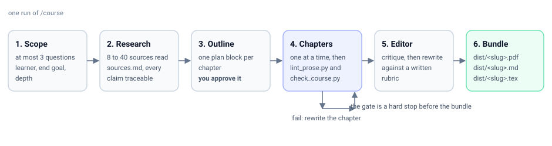

# principles-first

[](LICENSE)


A Claude Code plugin that turns a topic into a book-length course in the order a learner should meet it:
**the problems first, then one principle per chapter, and the tools only at the end.**

Most generated "courses" are a syllabus with the tools attached — fifteen platforms, forty commands, and no
attempt to explain why the field exists. This one refuses to do that, and a script enforces the refusal.

```bash
/plugin marketplace add sasajib/principles-first
/plugin install principles-first-courses@principles-first-courses
/course digital marketing
```



## The rule it will not break

Every course has three parts:

1. **The problems.** What the field exists to solve. No solutions yet.
2. **The principles.** One idea per chapter, taught as a mental model with worked examples and pseudocode.
   **No tools, no vendors, no programming languages.** `scripts/check_course.py` fails the build if one
   appears this early.
3. **The tools.** A map from each principle to the tools that implement it, applied chapters, then a capstone
   done by hand first and with tools second.

So a marketing course teaches "attention is scarce and is bought at the margin" before it names an ad
platform. A data-structures course teaches "first in, first out" in pseudocode before it names a language.
The order is the product: the principle survives the tool, and learners who meet tools first learn the tool
instead of the field.

## Why not just ask for a course?

You can. A single prompt gives you a plausible-looking outline in one reply, and it will read well. What it
will not give you is any of the following, because none of them can be enforced inside one reply:

| Without this plugin | What this plugin does instead |
|---|---|
| Sources implied or invented | 8 to 40 sources actually read, listed in `sources.md`, with single-source claims flagged and failures recorded in `research-log.md` |
| Structure drifts by chapter three | Chapter form is fixed in `templates/chapter.md`: a concrete situation to open, three to six content headings, each procedure applied step by step, a second example, where the principle breaks, a Summary and Exercises |
| Tools creep into the principles | A checker, not a reminder: a named tool or language before Part III fails the build |
| The house style of an AI | `scripts/lint_prose.py` rejects the catalogue in `references/writing-rules.md` — banned connectives, tricolons, "not just X but Y", bold mid-text, metronomic rhythm |
| One pass, no critique | `agents/book-editor.md` reads every chapter against `references/editor-rubric.md` and returns findings with SHIP or REVISE; the author revises each flagged chapter, up to two cycles |
| A chat log as the deliverable | A PDF, a single-file Markdown book, and LaTeX source — uploadable as is |

The honest limit: the scripts check form, provenance and surface style. They cannot check whether the
teaching is *good*. That is what the editor rubric and your own reading are for.

## Requirements

| Need | For | Install |
|---|---|---|
| Claude Code | everything | already there |
| Python 3.9 or newer | the checker, the prose linter, the bundler | `python3 --version` |
| Node.js and npm | Mermaid diagrams to SVG | `npm install` once in the plugin folder |
| `pandoc` | Markdown to PDF and LaTeX | `pacman -S pandoc`, `brew install pandoc`, `apt install pandoc` |
| `typst` | the PDF, via `templates/book.typ` | `pacman -S typst`, `brew install typst` |
| `rsvg-convert` (optional) | SVG diagrams as PNGs inside the PDF | `pacman -S librsvg`, `brew install librsvg` |
| `uvx`, `pipx` or `youtube-transcript-api` (optional) | reading YouTube transcripts as sources | `pipx install youtube-transcript-api` |

Missing `pandoc` or `typst` does not break the run: you still get the Markdown book, and the bundler says
what to install. Missing `rsvg-convert` means diagrams fall back to text drawings in the PDF.

## Install

```bash
# in Claude Code
/plugin marketplace add sasajib/principles-first
/plugin install principles-first-courses@principles-first-courses
```

From a local clone, while you edit the agents:

```bash
/plugin marketplace add ~/path/to/principles-first
/plugin install principles-first-courses@principles-first-courses
npm install
```

## Run it

Open Claude Code inside the repo, so courses land in `courses/`:

```bash
/course digital marketing                  # standard depth, the default
/course data structures and algorithms deep
/course courses/<slug>                     # add a chapter to an existing course
```

The skill asks at most three questions (who the learner is, what they should be able to do, how deep), shows
an outline to approve, then writes one chapter per file, runs the gate on each, and builds the bundle.
Say "no questions, just build" to skip the questions and the outline pause.

| Depth | Sources | Chapters | Use when |
|---|---|---|---|
| Quick | 8 to 12 | 6 to 8 | you want to see the shape, or the topic is narrow |
| Standard | 15 to 25 | 10 to 14 | the default |
| Deep | 25 to 40 | 16 to 24 | recursive research, a reference you will keep |

## What it costs

Be clear before you run it: a course is a book, not a chat answer. Standard depth is 15 to 25 sources read,
10 to 14 chapters at 2,000 to 4,500 words, plus a full-book editing pass that reads everything again.

That is hundreds of model calls on your own Claude Code plan, and the research and rewrite passes read far
more text than the output contains. I have not measured wall-clock time or token spend precisely, so I will
not quote a number. Budget hours of agent time, not minutes. Run a Quick course first to see the cost before
committing to a Deep one.

## Output

`courses/<slug>/dist/` is the uploadable bundle:

| File | Use |
|---|---|
| `<slug>.pdf` | Upload to any reader or knowledge base. Diagrams embedded as images. |
| `<slug>.md` | The whole book as one Markdown file; diagrams as text drawings, no external files. |
| `<slug>.tex` | LaTeX source, with images in `dist/diagrams/`. |
| `diagrams/*.png`, `*.svg` | Every diagram on its own. |

Rebuild any time:

```bash
python3 scripts/build_course.py courses/<slug> [--with-answers] [--formats md,pdf,tex]
```

`99-answers.md` is left out of the bundle on purpose, so a tutor reading it cannot hand out the answers.

## What a course looks like

```
courses/<slug>/
  course.json        manifest: parts, chapter list, forbidden terms, metadata
  outline.md         the approved plan, one block per chapter
  continuity.md      terminology, running-example facts, promises to the reader
  00-README.md       goal, who it is for, how to study, chapter table
  01-....md          Part I chapters, the problems
  0n-....md          Part II chapters, the principles (pseudocode only)
  0n-....md          Part III chapters, the tools, and the capstone
  99-answers.md      answers to every chapter's questions
  flashcards.tsv     Anki-importable
  sources.md         every source, single-source claims flagged
  research-log.md    what was searched, what was read, what failed
  diagrams/          SVGs rendered from the chapters' Mermaid blocks
  dist/              the built bundle
```

This repo ships no course. `courses/` is ignored except its own README, so whatever you generate stays
yours and cannot be published by this repository by accident.

## Enforced, not suggested

| Script | What it refuses |
|---|---|
| `scripts/check_course.py` | A named tool, vendor or language before the tools part; a missing Summary or Exercises; a chapter with no declared sources; a chapter count that contradicts the manifest. |
| `scripts/lint_prose.py` | The AI-writing tells catalogued in `references/writing-rules.md`: banned connectives, tricolons, "not just X but Y", bold mid-text, unhealthy sentence rhythm. |
| `scripts/build_course.py` | Nothing. It builds, and fails loudly if `pandoc` or `typst` are missing. |

The agents cannot skip the gate. `skills/course/SKILL.md` orders the run, and the gate is a hard stop before
the bundle is built.

## Repository layout

```
.claude-plugin/     plugin and marketplace manifests
skills/course/      the /course skill: scope, outline approval, gate, bundle
agents/             course-author, source-reader, book-editor, innovation-scout
references/         chapter-craft.md, writing-rules.md, editor-rubric.md (the standard)
scripts/            check_course.py, lint_prose.py, build_course.py, render_diagrams.mjs,
                    build_bundle.sh, youtube-transcript.sh
templates/          chapter.md (chapter form), book.typ (PDF book template)
assets/             flow.svg
courses/            where generated courses land; ignored here, so this repo ships no course
docs/               USAGE.md, PEDAGOGY.md, ARCHITECTURE.md
```

## Documentation

| Doc | Read it when |
|---|---|
| [docs/USAGE.md](docs/USAGE.md) | running `/course`, depth options, approving outlines, incremental mode, re-running the checks |
| [docs/PEDAGOGY.md](docs/PEDAGOGY.md) | the six rules the author follows and the learning research behind them |
| [docs/ARCHITECTURE.md](docs/ARCHITECTURE.md) | how the skill, agents and scripts fit together, and how to change them |

## Licence and credits

MIT. See [LICENSE](LICENSE) and [NOTICE](NOTICE).

The research pipeline is adapted from [klausners/course-builder](https://github.com/klausners/course-builder).
The writing rules and the anti-AI catalogue are adapted from
[luquiluke/claude-book-skill](https://github.com/luquiluke/claude-book-skill) and
[blader/humanizer](https://github.com/blader/humanizer). The editor loop and the "counted by a script" rule
follow [seba-cascardo/book-factory](https://github.com/seba-cascardo/book-factory). All MIT. Diagrams are
rendered with [beautiful-mermaid](https://github.com/lukilabs/beautiful-mermaid) (MIT). PDF via
[pandoc](https://pandoc.org) and [Typst](https://github.com/typst/typst).
