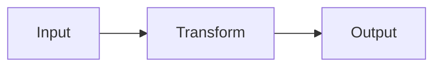

# <N>. <Chapter title>

<Opening, no heading: two to five paragraphs inside a concrete situation. A specific
person, product or case, and what goes wrong. Then one short paragraph on what the
reader will be able to do after this chapter. Do not define the term yet.>

## <Heading that names what this section shows>

<Intuition: why the naive approach fails, through the scene or a second case.>

## <Heading that names the principle in content terms>

<The principle stated once, plainly, with a mental model. The **term** in bold on
first definition only.>

## <Heading naming the procedure applied to the scene>

<Pseudocode or numbered procedure, then applied step by step with intermediate states
visible. Parts I and II: tagged `pseudo`, never a real language.>

```pseudo
procedure NAME(input):
    step 1
    step 2
    return result
```

<A diagram only when structure or flow is easier to see than to read; one caption
sentence after it.>



## <Heading naming the second example or real case>

<A different domain or a real case from the sources with its real figures.>

## <Heading naming the limit or counter-view>

<Where it breaks: trade-offs, the strongest counter-view, how practitioners reconcile.
Part III chapters: which principle chapters this tool implements, by number, and what
the tool hides from you.>

## Summary

- Four to seven standalone claims the reader could repeat without the chapter.

## Exercises

1. <recall>
2. <explain>
3. <apply, with given data>
4. <own case, ends with "Done when ...">

(No answers here; they go in `99-answers.md` under `## <N>. <Chapter title>`. No
sources here; every number, study, quote or framework goes in `sources.md` under the
same heading.)
