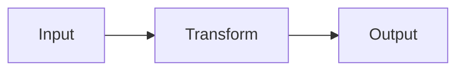

# <N>. <Chapter title>

**The problem.** Two to five sentences: a concrete situation and what goes wrong without the idea this chapter teaches.

**The question this chapter answers.** One line.

## The principle

Plain explanation. Mental model or analogy. A diagram only when structure or flow matters:



Phase 3 chapters: list which Phase 2 principles this tool implements ("implements chapter 4 and chapter 6") and what the tool hides from you.

## Walkthrough

A worked example done by hand. Show intermediate states.

```pseudo
procedure NAME(input):
    step 1
    step 2
    return result
```

Phase 1 and 2: pseudocode only, never a real language. Phase 3: real code is allowed.

## Where it breaks

Limits, trade-offs, common mistakes, what experts disagree about.

## Check yourself

1. Question one.
2. Question two.
3. Question three.

(No answers here. They go in `99-answers.md` under `## <N>. <Chapter title>`.)

## Do it by hand

One exercise solvable with paper or a text editor. State the expected output or a rubric. Phase 3: "Do it with the tool, then explain which principle each step applied."

## Sources

- Author or org — Title — https://example.com   [single-source] where applicable
